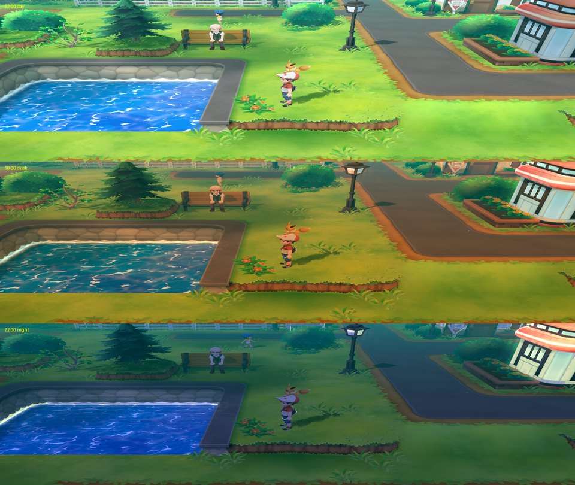
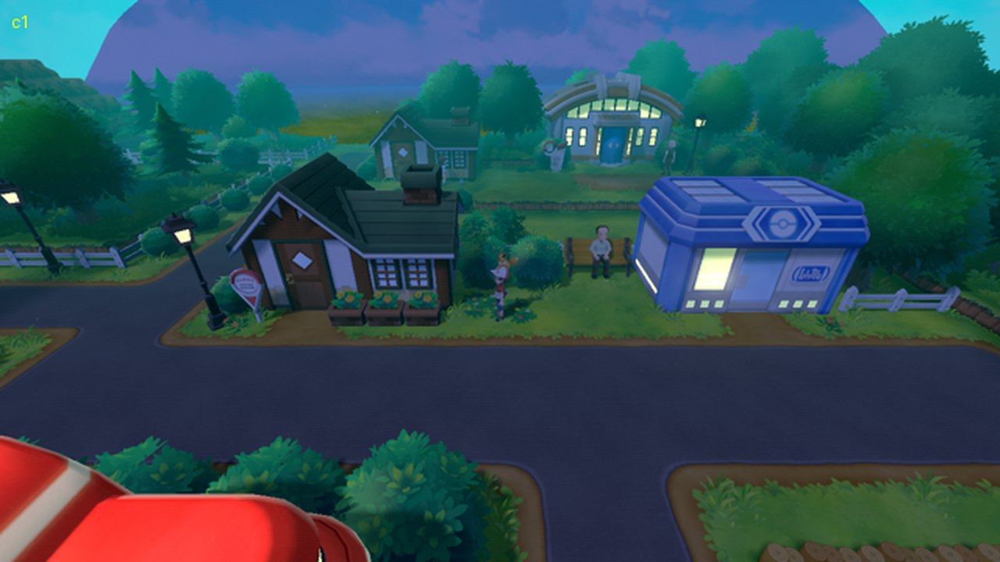
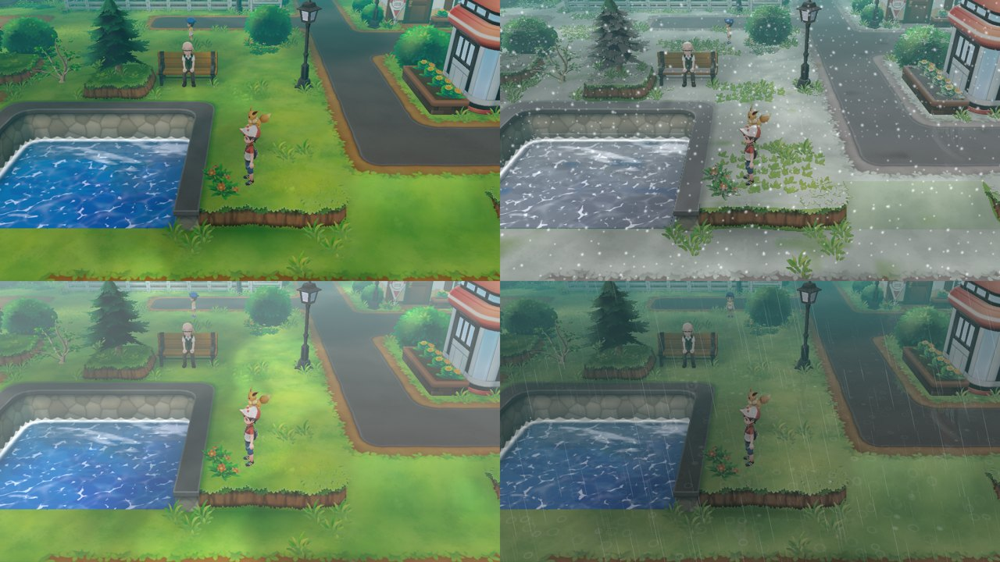
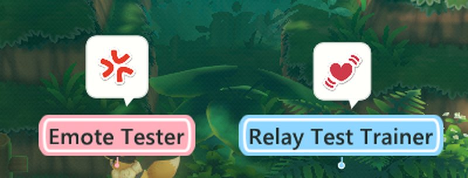
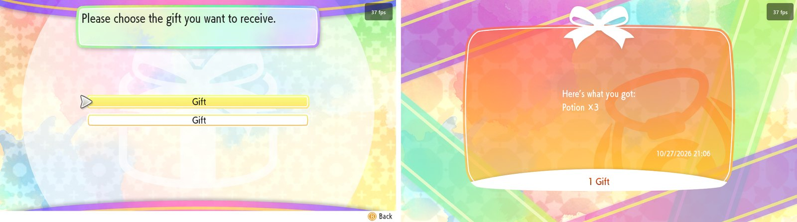
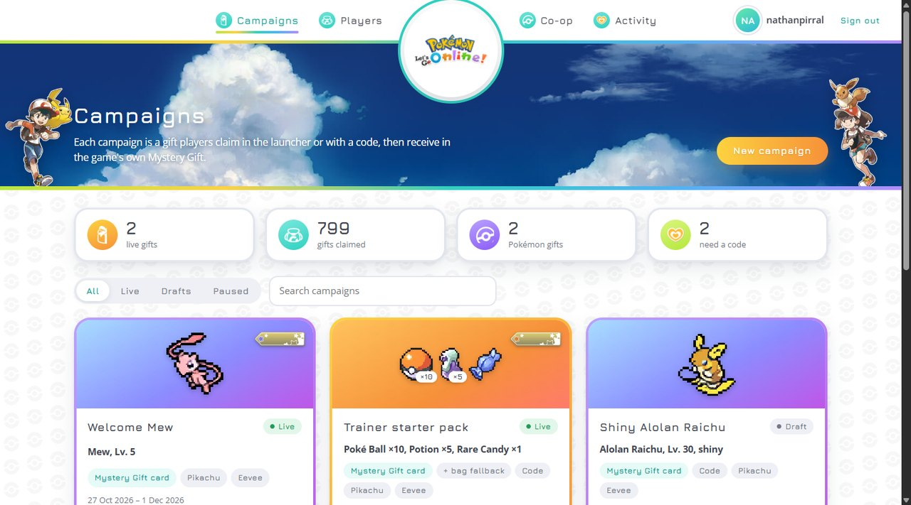
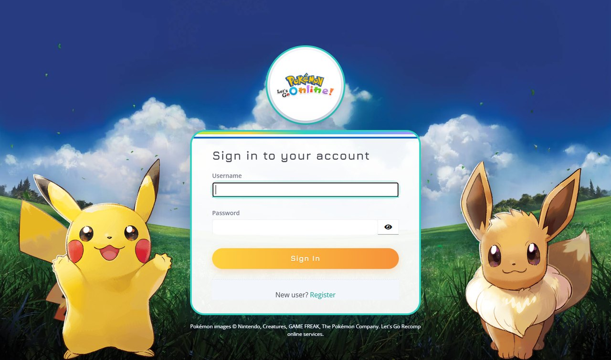

  

<h1 align="center">Let's Go Online!</h1>

  A native Windows port of <b>Pokémon: Let's Go, Eevee!</b> and <b>Let's Go, Pikachu!</b>, with day and night,
  weather, online co-op and Mystery Gifts of our own.

**Let's Go Online!** is made by **static recompilation**: the game's ARM64 code is translated into C and compiled for your PC, and
a runtime stands in for the Switch (system services, NVN graphics on Vulkan, audio, controllers). **It is not an
emulator.** Built on **[LAS Recomp](https://github.com/peiikai/LASRecomp)** by Peiikai and
the **[Let's Go Recomp](https://github.com/raulzrrs/letsgo-recomp)** port, and adds its own online services: accounts,
co-op and Mystery Gifts.

> [!IMPORTANT]
> **No game files are included.** You need your own legally obtained copy of *Let's Go, Eevee!* or *Pikachu!*,
> extracted (the `exefs` and `romfs` folders). A fan project, not affiliated with Nintendo, The Pokémon Company, Game
> Freak or Creatures.

> [!NOTE]
> **Work in progress.** The game hasn't been played from start to finish on this port yet, and the online features
> are experimental. Bug reports, fixes and improvements are very welcome: open an issue or a pull request
> ([CONTRIBUTING.md](CONTRIBUTING.md)).

*The same frame rendered by the port with the game's original settings (left) and the enhanced ones (right); below,
the marked area at 2x. Not Switch captures.* ▶ [Showcase video](https://youtu.be/mGk-wBu1wCk)

## Contents

- [Features](#features)
- [Day, night and weather](#day-night-and-weather)
- [Online co-op](#online-co-op)
- [Mystery Gifts](#mystery-gifts)
- [Online services and the admin dashboard](#online-services-and-the-admin-dashboard)
- [Launcher and settings](#launcher-and-settings)
- [Requirements](#requirements) · [Supported games](#supported-games) · [How to play](#how-to-play) · [Mods](#mods)
- [Known issues](#known-issues) · [Credits](#credits) · [License](#license)

## Features

**Graphics and performance**

- Native code, up to **4K** internal resolution, any window size, fullscreen
- Anti-aliasing **SMAA**, **TAA** or **AMD FSR 3.1** (also upscales); **FSR 1** for a lower resolution
- **Ambient occlusion** (SSAO, with contact shadows at Ultra) and **indirect light (GI)**, smooth shadows, 16x anisotropic filtering
- The game's **30 fps**, or **60 / 120 fps** in the overworld (experimental), plus **frame generation** (2x / 3x / 4x, any GPU)
- **2x interface** images and sharper text; shaders cached on disk

**World**

- Experimental **day and night** that follows your clock or a fixed hour, with a moving sun, lit windows, street lamps,
  fireflies and the moon on water ([details](docs/DAYNIGHT.md))
- Experimental **weather**: clouds and cloud shadows, rain, snow, fog and storms

**Play**

- Keyboard and mouse (aim Poké Balls, touch screen) and any controller, with the Nintendo or Xbox button layout; every key rebindable
- Experimental **wild battles** (on by default): classic combat, defeat XP and catching from the battle Bag on Eevee 1.0.0; plus **skip controller selection**
- Experimental **two-controller local co-op input**
- **Mods**: fan translations and other LayeredFS mods, several at once

**Online**

- Experimental **social online co-op**: independent saves, other trainers in your world, nameplates, an emote wheel
  with speech bubbles, invitations and trainer team-ups ([setup and limits](docs/COOP-ONLINE.md))
- Experimental **accounts and Mystery Gifts**: claim items or Pokémon in the launcher or with a code, and receive them
  in the game's own **Mystery Gift**
- An **admin dashboard** to run gift campaigns, codes, players and co-op rooms

## Day, night and weather

Off by default: turn it on in the launcher's **Image & sound** page or the in-game settings. The outdoors follow your
clock or a fixed hour; battles keep the hour's light; interiors and caves are unchanged.

<i>Viridian City at noon, 18:30 and 22:00.</i>

<table>
<tr>
<td></td>
<td></td>
</tr>
<tr>
<td align="center"><i>Night: lit windows and street lamps.</i></td>
<td align="center"><i>Weather: cloudy, snow, fog and storm.</i></td>
</tr>
</table>

## Online co-op

Play side by side with friends, each on your own save: see each other in the world, send emotes (**R3 / F10** opens
the wheel), invite each other and team up against trainers. Join from **Communicate → Play With Others**, the
launcher or **F8**. The relay never receives saves, inventory or story state.

Setup, protocol and limits: [docs/COOP-ONLINE.md](docs/COOP-ONLINE.md).

## Mystery Gifts

Sign in on the launcher's **Account** page and link your save. Gifts then show up on the **Gifts** page (or claim one
with a code). In the game, open **Mystery Gift → Get via internet**: the game's own Mystery Gift receives our gifts,
adds them like an official distribution and saves. Then the launcher confirms the delivery.

<i>The game's own Mystery Gift listing two of our gifts, and receiving one.</i>

- **Items**: any of the 207 items that can safely be given (no TMs or story key items), up to 6 per gift
- **Pokémon**: any of the 153 Pokémon in Let's Go, Alolan forms included, with level, shiny, nature, gender, IVs,
  moves and Poké Ball; the player who receives it is its trainer
- Every gift is received once per save; the save itself records it, and a crash during saving can't give it twice
- Codes can also be typed in the game's **Get with code/password** screen (Eevee 1.0.0)

Design and status: [docs/ACCOUNTS-MYSTERY-GIFTS.md](docs/ACCOUNTS-MYSTERY-GIFTS.md) and its
[roadmap](docs/ACCOUNTS-MYSTERY-GIFTS-ROADMAP.md).

## Online services and the admin dashboard

Let's Go Online! runs its services as one Docker Compose project, [`server/accounts/compose.yml`](server/accounts/compose.yml):

- **Accounts and Mystery Gift API** with PostgreSQL: accounts, linked saves, campaigns, codes and claims
- **Admin dashboard** at `/admin/`: create gift campaigns with item and Pokémon pickers and a live card preview,
  publish or pause them, make codes, see claims, manage players, watch and close co-op rooms, read the activity log
- **Co-op relay**
- **Keycloak** (profile `identity`) for sign-in, with a Let's Go login theme

<table>
<tr>
<td width="50%"></td>
<td>Staff and players sign in with Keycloak through the Let's Go login theme. The dashboard and the theme take their
artwork from your own game files and the official Let's Go website, collected into a local folder by
<code>server/accounts/dashboard/collect_assets.py</code> and never committed.</td>
</tr>
</table>

Setup, configuration and operations: [server/accounts/README.md](server/accounts/README.md).

## Launcher and settings

<table>
<tr>
<td></td>
<td></td>
<td></td>
</tr>
</table>

In the game, **F12** opens the same settings, applied at once. On **Eevee 1.0.0**, the game's own **Options** list
also includes the extra graphics, image, audio and advanced settings; change them with left/right.

## Requirements

| | |
|---|---|
| OS | Windows 10 or 11, 64-bit |
| CPU | x86-64 with SSE4.2 (Intel Nehalem / AMD Bulldozer or newer); AVX2 (Intel Haswell / AMD Zen or newer) recommended: without it the game code is built for older CPUs and runs slower |
| GPU | Vulkan 1.3 |
| RAM | about 4 GB while playing (5.2 GB during the one-time setup) |
| Disk | about 6 GB free |
| Online services (optional) | Docker (Compose), to host your own accounts, gifts and relay |

## Supported games

- *Let's Go, Eevee!* and *Let's Go, Pikachu!*, any region, from your own dump (cartridge or eShop)
- **1.0.0** (the base game) for every option; the 1.0.1 / 1.0.2 updates are accepted, less tested, without the frame
  rate, wild battles and controller options
- `.xci` / `.nsp` files must be extracted first

Most tested with *Eevee* 1.0.0; *Pikachu* 1.0.0 less.

## How to play

1. Download `LetsGoRecomp-<version>-windows.zip` from [Releases](../../releases) and unzip it into a folder you can
   write to.
2. Open **`LetsGoRecomp.exe`** (if Windows warns, **More info** → **Run anyway**).
3. On the **Game** page, click **Select game folder...** and pick the folder with `exefs` and `romfs`.
4. Wait while it copies the files and recompiles the game for your PC (only once: 22 minutes measured on a 20-thread
   CPU, longer with fewer threads).
5. Click **Play**.

Everything stays in that folder (settings, saves, mods). To update, unzip a new release over it. For both games, use
one folder each.

## Mods

On the **Mods** page, **Install a mod...** takes the `.zip` / `.rar` / `.7z` as downloaded (Atmosphere LayeredFS
packs: translations, textures, models). Tick the ones to use; where two change the same file, the higher one wins.
Mods of the game's code (exefs, IPS, cheats) don't work. Tested with the Brazilian Portuguese fan translation by
**Pokémon Switch Brasil** (not included; distributed by its authors). The launcher and settings are in English only.

## Known issues

- 60 / 120 fps and frame generation are experimental; battles and captures stay at 30 fps
- Classic wild combat, defeat XP and catching from the battle Bag currently require Eevee 1.0.0; Pikachu retains battle followed by capture
- Switching to TAA while playing shows one or two black frames
- The 2x interface shows a few frames of thin stripes during an area change
- Nintendo's online features, local wireless and the Poké Ball Plus aren't supported. The co-op relay is experimental;
  shared battles, trades and story progression are not implemented
- Mystery Gifts are experimental. Receiving item gifts in the game's Mystery Gift is verified on Eevee 1.0.0;
  receiving Pokémon, the full launcher-to-game delivery and typing codes in the game are not verified in the game yet

Crashes: please open an issue with `lasrecomp.log` ([CONTRIBUTING.md](CONTRIBUTING.md)). What changed in each
release: [CHANGELOG.md](CHANGELOG.md).

## Credits

- **[LAS Recomp](https://github.com/peiikai/LASRecomp)** by **Peiikai**: the recompiler and runtime this port is built on
- **[Let's Go Recomp](https://github.com/raulzrrs/letsgo-recomp)** (raulzrrs): the Let's Go port this project builds on
- **Iván Serrano ([@Vancete](https://github.com/Vancete))**: the F12 menu, TAA and FSR 3.1, the 2x interface and
  sharper text, frame generation (FSR 3.1's, then the in-house 2x / 3x / 4x), 120 fps and the walking fix, skipping
  the controller screen, the menus' look, the Xbox controller layout, SSAO Ultra
- **Pokémon Switch Brasil**: the Brazilian Portuguese fan translation used in testing
- **[PKHeX](https://github.com/kwsch/PKHeX)**: its Let's Go save and Mystery Gift card formats and game data guided
  the Mystery Gift work (test tools only; the item, Pokémon and move catalog was generated from it)
- The **Let's Go Online!** logo is this project's own. The dashboard's and the sign-in page's style follows the
  official [Let's Go website](https://pokemonletsgo.pokemon.com/); the project icon is a Poké Ball drawn after its
  favicon
- Libraries: SDL 3, FFmpeg (LGPL), Dear ImGui, Vulkan Memory Allocator, shaderc, SMAA, AMD FidelityFX (FSR 1, FSR 3.1),
  bcdec, stb, waifu2x-ncnn-vulkan, the Baloo 2 font (OFL), Capstone, Unicorn, PyInstaller, Zig; the server uses
  FastAPI, PostgreSQL and Keycloak

## License

The code in this repository is under the [MIT license](LICENSE), like LAS Recomp; third-party components keep their
own licenses. It grants no rights to the game. *Pokémon* and *Let's Go* are trademarks of their respective owners.
Pokémon images and the Poké Ball design © Nintendo, Creatures, GAME FREAK, The Pokémon Company. Screenshots show the
game running on this port.
