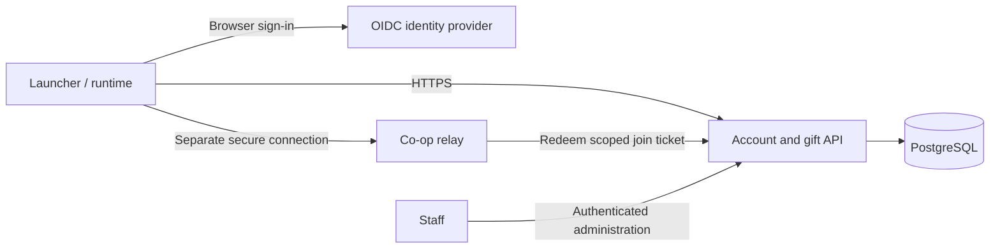

# Accounts and Mystery Gifts: proposed design

Status: backend and Windows launcher sign-in implemented 27 October 2026: [`server/accounts/`](../server/accounts/README.md), profiles, campaigns, codes, transactional gift entitlements and [launcher Account page](ACCOUNTS-LAUNCHER.md). The remainder describes the target design; native gift delivery, in-game account UI and relay account handoff remain unimplemented. Accounts remain optional for solo play and existing room-code Social co-op. Shared progression and server-owned saves are not enabled.

Continuation: launcher profile binding, gift browsing, preview and retry-safe explicit claiming are implemented. The latest 14-test evidence, correction of the earlier missing-glyph interpretation, and the next agent's A04 save-recovery gate are in the [handoff roadmap](ACCOUNTS-MYSTERY-GIFTS-ROADMAP.md#latest-continuation-a02v-and-a03-27-october-2026). Claims still reserve only server entitlements; no rewards are applied to saves.

## OpenMMO reference inspection

Inspected [OpenMMO](https://github.com/openmmo-org/OpenMMO/tree/a0876357961f383de1c54fc71a7e3cd4b2a1fe58) at commit `a0876357961f383de1c54fc71a7e3cd4b2a1fe58`. Source checkout: `tests/runs/account-gift-research-20261027-01/OpenMMO/`. Inspection covered the login handlers, user store, token implementations, migrations, character storage and deployment files; its servers and tests were not run.

| Area | Observed implementation | Application here |
| --- | --- | --- |
| Account storage | Login PostgreSQL database; unique lowercase username, display name, password hash and token epoch | Separate persistent account identity from local trainer names and relay identities |
| Login | `server.login/.../handler/LoginAppHandler.kt` handles password and saved-token login | Use an established identity system instead of reproducing its custom login protocol |
| Remember me | HMAC-SHA256 token with user ID, epoch and timestamp; login checks the database epoch and issues a renewed token | Support revocable sessions; renewal alone is not single-use refresh-token rotation |
| Game handoff | Login sends a server address and HMAC-authenticated session token; default maximum age is five minutes | Issue short-lived credentials scoped to our relay, rather than forwarding long-lived login credentials |
| Persistence | Login and game have separate PostgreSQL databases; game character storage includes party, inventory and story state with cached writes | Keep account/claim storage separate from transient relay state; preserve our local saves |
| Deployment | Separate login/game Compose stacks, private databases, health checks, mounted key file and environment configuration | Start with a small deployment and explicit secrets, backups and migrations |
| Mystery Gift | Repository search found generated dialogue and `CableClub_EventScript_MysteryGiftMan` with a TODO body; no implemented redemption service was found | Design our own campaign and claim ledger |

Primary reference files, relative to the pinned tree above:

- `server.login/src/main/kotlin/de/fiereu/openmmo/server/login/auth/{JooqUserStore,AdminAccountBootstrap}.kt`
- `server.login/src/main/kotlin/de/fiereu/openmmo/server/login/handler/LoginAppHandler.kt`
- `common/src/main/kotlin/de/fiereu/openmmo/common/auth/{SessionToken,RememberMeToken}.kt`
- `server.login/src/main/resources/db/migration/`
- `server.game/src/main/kotlin/de/fiereu/openmmo/server/game/storage/CharacterStore.kt`
- `server.game/src/main/kotlin/de/fiereu/openmmo/server/game/script/generated/hoenn/BattleFrontier_PokemonCenter_2F.kt`
- `deploy/{login,game}.compose.yml`

Its unsalted SHA-1 password representation is a retail-client compatibility constraint, not a pattern to adopt here. Its initial-account bootstrap creates a user on an empty database; that code alone does not establish a complete administrator permission system. We should implement explicit staff roles. This proposal uses architectural observations, without copying source.

## Service layout

Proposed starting stack: a Python HTTPS API, PostgreSQL and a TLS reverse proxy, alongside the existing Python relay. Keep account and gift modules in one API deployment initially; there is no need for separate machines, databases per module or a queue at this scale. Use a maintained OIDC provider for registration, recovery and browser authentication. Select its hosting and operational cost before implementation.

The relay continues owning temporary rooms, poses and battle messages. The API owns durable account IDs, profile bindings, campaigns and claims. API downtime leaves solo play and existing guest rooms available; new account-authenticated connections and claims fail with a bounded, retryable error.

The current relay is plain TCP, and the native console network services are offline stubs. New credentials require a real host-side HTTPS client with certificate validation. Public authenticated relay sessions require TLS or another authenticated encrypted transport first. Do not send account tokens over the existing plaintext connection or enable the console's network stubs globally.

## Accounts and profiles

- Browser authorization code flow with PKCE S256, state and OIDC nonce. Validate issuer, audience and redirect URI. Native apps are public clients with no embedded client secret. Use a vetted OAuth/OIDC client. See [RFC 8252](https://www.rfc-editor.org/rfc/rfc8252.html) and [OAuth security guidance](https://www.rfc-editor.org/rfc/rfc9700.html).
- Store persistent credentials in the OS credential store, scoped by service environment and account. Keep access tokens in memory. Never store tokens in `coop.ini`, saves, crash reports or ordinary logs. Support logout, session revocation and account recovery through the identity provider.
- Identify a login by `(issuer, subject)`, not email or display name. A public trainer name can differ from the account handle. Linking another identity requires fresh authentication and explicit confirmation.
- One account can bind multiple local profiles, with explicit selection of the destination before claiming. Assign a random profile UUID; trainer IDs and save hashes are not proof of ownership. A changing save hash cannot be the stable profile ID.
- Profile binding establishes a delivery destination, not trusted game-state attestation. Copies can copy their profile UUID. Account-wide claim limits therefore remain the default even across Pikachu/Eevee profiles. Profile rebinding never resets account claim history.
- Use a short-lived opaque relay ticket, bound to account, relay audience and intended operation. Redeem it once through the API over an authenticated service connection. Long-lived refresh credentials never reach the relay. Add a versioned relay handshake without reinterpreting protocol-6 identity bytes as an account ID.

## Mystery Gift experience and campaign model

Offer **Mystery Gift -> Available gifts / Enter code / Pending deliveries / Received gifts**. Sign-in is required only for claiming and account history. Show contents, compatibility, expiry and destination trainer before confirmation. Errors include full bag/boxes, unsupported build, expired campaign, already claimed and service unavailable; every network wait has a timeout and cancellation.

Initially expose this through the project UI. Reusing the original game menu requires a separately mapped hook: its current spinner is not a functional backend integration point.

Campaigns contain an immutable published revision, title, UTC claim window, enabled flag, supported game/build adapters, delivery schema, eligibility policy, reward definition and optional finite stock. First release: one fixed item bundle per account per campaign, plus public codes and optional random single-use codes. Pokemon distributions follow after item delivery and crash recovery are verified.

For Pokemon gifts, validate species, form, moves, level, ability and serialization against the supported game version. Generate any random reward once at claim creation and retain it across retries. Payloads contain bounded typed data, never scripts, arbitrary memory addresses or file paths. Clients retain their own validation even for staff-authored gifts.

## Storage and API contract

| Record | Essential fields and invariants |
| --- | --- |
| Account / identity | UUID, status; unique `(issuer, subject)` |
| Profile binding | UUID, owner account, game edition, label; no uploaded whole save |
| Session | Revocable API session metadata; provider credentials handled by the auth layer |
| Campaign / revision | Stable campaign ID, immutable published reward revision, window, stock and status |
| Code | Campaign ID, keyed digest for private codes, use limit and count; normalize input consistently |
| Claim | UUID, account, campaign, destination profile, revision, frozen reward payload/digest, state and timestamps |
| Request key | Unique `(account, operation, idempotency_key)`, request digest and recorded response |
| Audit event | Actor, action, target, request ID and time; no credentials or private codes |

Use a database unique constraint on `(account_id, campaign_id)` for the first release. A different request key must not bypass it. A repeated key with a different request digest returns conflict. Campaign revisions do not reset eligibility. Database constraints enforce uniqueness under concurrent requests; see [PostgreSQL constraints](https://www.postgresql.org/docs/current/ddl-constraints.html).

Proposed endpoints:

| Endpoint | Behavior |
| --- | --- |
| `GET /v1/me` | Current account and permissions |
| `POST /v1/profiles` | Explicitly bind a local destination |
| `GET /v1/gifts` | List campaign metadata and account claim status |
| `POST /v1/claims` | Campaign or code, destination, adapter version; requires idempotency key |
| `GET /v1/claims` | Resume pending deliveries and display history |
| `POST /v1/claims/{id}/ack` | Idempotently record client-reported durable delivery |
| `POST /v1/relay-tickets` | Issue a scoped short-lived join credential |

All claim reads and writes enforce account ownership. Claim creation atomically checks campaign status/window, consumes code/stock if applicable and inserts the immutable claim. Lock or conditionally update stock/code counters within that transaction. A lost HTTP response returns the same existing claim on retry. Codes create no alternate reward path. Never release a committed claim or restock automatically merely because an acknowledgement times out.

Staff operations require separate authorization, MFA and an audit trail: draft, preview, publish, pause and inspect claims. Published payloads cannot be edited in place. Pausing stops new claims; already allocated deliveries remain recoverable unless explicitly quarantined for a defective payload. Never silently remove rewards from local saves.

## Delivery, crashes and the local-save boundary

The server can guarantee one entitlement per account/campaign. It cannot prove exactly-once effects in arbitrary editable, restorable local saves. Client acknowledgements are reports, not attestation. Restoring an old save, cloning it or modifying the runtime defeats an economy-wide uniqueness guarantee. This design accepts that boundary and does not establish a trusted trading economy.

For supported unmodified clients, delivery must use a recoverable local transaction:

1. Receive the committed claim and validate its destination, adapter, payload and capacity. A full destination leaves it pending without discarding it.
2. Acquire an exclusive profile delivery lock and reach a verified idle gameplay checkpoint. Serialize against autosave, reset, other gift deliveries and battle transitions.
3. Durably journal the claim ID and pre-delivery save generation before mutation, with a recoverable save copy. Apply only the intended reward through a mapped game adapter.
4. Persist the reward and a receipt tied to the same committed save generation. Prefer a verified native gift receipt if one exists. Otherwise implement a coordinated save-generation transaction with journal replay; writing an unrelated sidecar receipt after a normal save leaves a crash window.
5. Verify the committed generation, then acknowledge the server. If acknowledgement fails, retry it without applying the reward again. Startup recovery completes before normal gameplay or another delivery.

Recovery distinguishes prepared-only, committed-without-ack and inconsistent state. Prepared-only can resume from a verified generation; committed-without-ack only resends acknowledgement. Inconsistent state is quarantined with a useful recovery message, rather than guessing from an item count or granting again.

**Implementation gate:** the native save is now replaced atomically (`runtime/services/fs.c`, A04a in the [roadmap](ACCOUNTS-MYSTERY-GIFTS-ROADMAP.md#a04a-atomic-native-save-27-october-2026)): the game's `SetSize(0)` + whole 1 MB Write goes to a flushed copy that replaces `savedata.bin`, tested on copied saves at each crash/write-failure boundary. Item insertion and the generation-bound receipt (A04b) remain before normal-save delivery. Keep all initial delivery experiments on isolated copied saves.

## Deployment and implementation sequence

Use private database networking, migrations, production secrets supplied outside source control, separate staging identities/campaigns, bounded request sizes, login/code rate limits and structured redacted logs. Pin deployment versions. Back up and restore-test both the claim ledger and authentication configuration. A ledger restored behind previously issued claims can permit duplicate entitlements; reconcile durable claim records before reopening writes after recovery. Define retention and account deletion behavior explicitly.

1. Build API/account skeleton and browser sign-in; verify logout/revocation and profile isolation.
2. Implement campaign administration and transactional claim ledger, with no game mutation. Verify concurrency, stock/code limits, ownership and retries against PostgreSQL.
3. Map item delivery and save receipts on copied saves. Extend existing `tests/scripts/` and `tests/tools/` harnesses. Crash before/after each journal/save/ack boundary, restart and compare full relevant save state, including unintended rewards and story flags.
4. Add the player-facing gift UI and exercise visible success, timeout, cancellation, full capacity, wrong version, wrong profile and restart recovery. Verify only the selected client's save changes in two-client tests.
5. Add secure account-aware relay handoff, preserving optional room-code guest play. Pokemon gifts follow as a separate adapter and fixture set.

Before enabling delivery, demonstrate no duplicate application across supported retry/crash paths, durable recovery after process termination, unchanged unrelated save fields and cleanly handled disk-write failures. These are future native-delivery acceptance checks; the backend tests below do not establish game-save safety.

## Backend implementation evidence (27 October 2026)

The backend in `server/accounts/` passed 11 PostgreSQL/API integration scenarios, including concurrent same-account claims, finite-stock races, single-use code races, injected transaction failure, refresh replay, authorization/MFA checks and real HTTP persistence across process restarts. The real existing Keycloak instance also completed authorization-code/PKCE login for a disposable QA user: wrong verifier, reused authorization code, password grant and ID-token exchange were rejected. The existing `johto-online` client configuration remained unchanged, and the QA user was deleted.

Evidence: `tests/runs/account-gift-api-20261027-122459-fde93f/` (`pytest.log`, `junit.xml`, `keycloak-verification.json`, `database.sql`, and owned process/container IDs). The test harness and artifacts are local and git-ignored. The suite has one upstream Starlette deprecation warning about its httpx testing transport; all tests passed.

Local Docker deployment uses the new `letsgo-accounts` Compose project, separate PostgreSQL storage and `127.0.0.1:7385`. Keycloak uses the existing `johto` realm with a dedicated `letsgo-native` public client, S256 PKCE and `letsgo-api` access-token audience. Local private configuration is under `tests/config/letsgo-accounts.env`. Startup, readiness, OpenAPI/docs, authentication rejection and container-to-Keycloak JWKS connectivity were checked. Deployment smoke evidence is recorded alongside the passing test run.

No game was launched or save modified for the initial backend work. Staff endpoints enforce recent MFA; the shared Keycloak realm's staff MFA flow has not been changed or independently verified. The local deployment uses development HTTP and is not a public production deployment.

Launcher integration evidence: `tests/runs/account-gift-api-20261027-125641-87add3/` passed all 12 API/launcher scenarios with an isolated Docker API and real existing Keycloak. `launcher/verification.json` records sign-in, remembered credential restoration, sign-out/session-only revocation, callback validation, cancellation, port conflict, timeout, unavailable-service handling and unchanged original saves/settings. Screenshots under `launcher/signin/`, `launcher/restore/`, `launcher/session-only/`, `launcher/timeout/` and `launcher/unavailable/` were inspected. Native URL/JSON/Unicode and credential-shutdown checks passed (`tests/logs/account-native-probe.log`). The isolated executable was copied to the idle normal `build/LetsGoRecomp.exe`; its predecessor is preserved in that run. The local API was rebuilt with browser completion and Docker-internal Keycloak routing. QA users, credential entries, containers and launcher processes were cleaned up. Only the intended local API/database services remain running.
